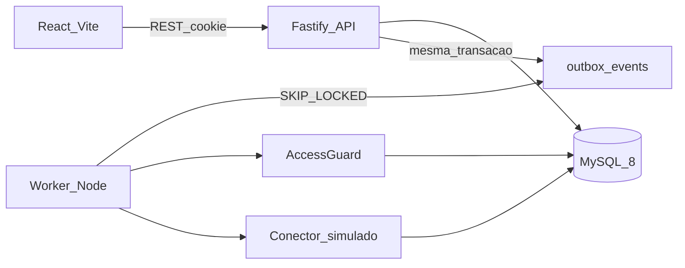
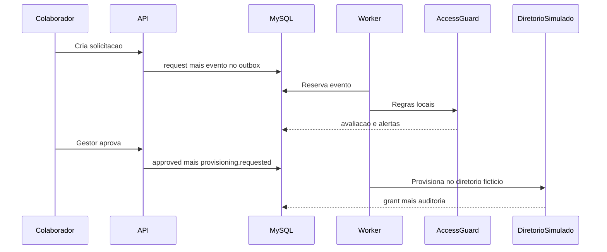

# Arquitetura

AccessFlow é um monólito modular local. Três processos são possíveis. No desenvolvimento normal sobem dois: a API e o Vite. O worker de outbox roda dentro da API quando `ACCESSFLOW_EMBED_WORKER=true`. Um script separado existe para mostrar o worker em processo próprio, sem exigir três processos o tempo todo.

## Módulos

Cada módulo da API tem rotas, serviço e repositório SQL. Módulos se chamam por função explícita ou por evento do outbox. Não há barramento externo.

| Módulo | Responsabilidade |
| --- | --- |
| `identity` | Pessoas fictícias, papéis (`employee`, `manager`, `admin`, `security_analyst`) e sessão |
| `catalog` | Sistemas e perfis fictícios, com marca de privilegiado e pares de SoD |
| `access-requests` | Ciclo da solicitação |
| `access-guard` | Regras de risco e persistência da avaliação. Não provisiona sozinho |
| `provisioning` | Conector que grava concessões no diretório simulado |
| `audit` | Trilha append-only das mudanças de estado |
| `outbox` | Gravação do evento na mesma transação e consumo idempotente |

O contrato compartilhado de eventos e esquemas Zod fica em `packages/contracts`. A especificação legível está em [contracts.md](contracts.md), [data-model.md](data-model.md), [api.md](api.md) e [events.md](events.md).

Os módulos permanecem no mesmo processo. A fronteira atual (rotas, serviço, repositório e eventos) é o que permitiria separar um módulo no futuro, sem fazer isso agora. O detalhe está em [contracts.md](contracts.md).

## Fluxo de solicitação

## Persistência

MySQL 8.3 em `127.0.0.1:3306`, banco `accessflow`, tabelas InnoDB, driver `mysql2`. Migrações são arquivos SQL numerados com um runner pequeno na API. A primeira versão não usa ORM.

Dialeto combinado:

- ids `CHAR(36)` gerados na aplicação com `crypto.randomUUID()` antes do `INSERT`;
- payload de evento em coluna `JSON`;
- datas em `DATETIME(3)`, gravadas em UTC;
- placeholders `?`;
- reserva do outbox com `SELECT ... FOR UPDATE SKIP LOCKED` dentro da transação.

PostgreSQL não é dependência, alternativa nem caminho opcional. SQLite também fica de fora nesta versão.

## Processos

| Comando planejado | O que sobe |
| --- | --- |
| `npm run dev` | API com worker embutido e Vite |
| `npm run dev:worker` | Worker em processo separado |

`npm run dev` sobe os dois primeiros. O worker separado ainda não está implementado. Ver [roadmap.md](roadmap.md).

## Decisões

- [0001 Monólito modular](adr/0001-modular-monolith.md)
- [0002 Somente MySQL](adr/0002-mysql-only.md)
- [0003 Transactional outbox](adr/0003-transactional-outbox.md)
- [0004 AccessGuard determinístico](adr/0004-deterministic-accessguard.md)
- [0005 Diretório simulado](adr/0005-simulated-directory.md)
- [0006 Sem vulnerabilidade ativa](adr/0006-no-live-vulnerabilities.md)
- [0007 Papéis da aplicação](adr/0007-application-roles.md)
